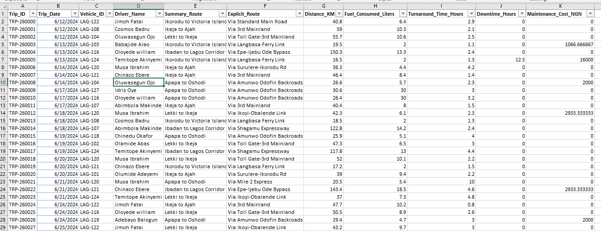
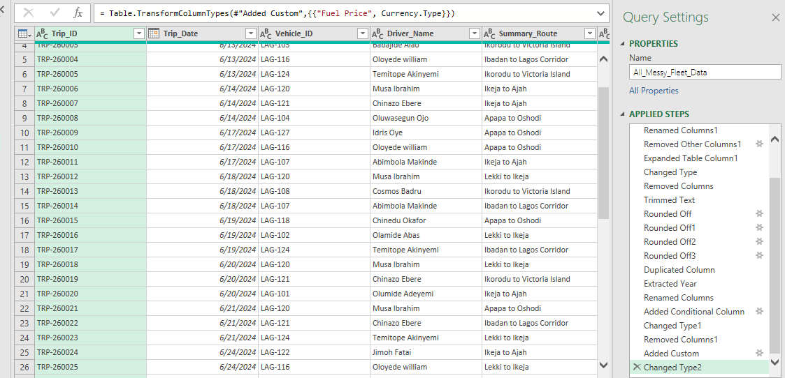
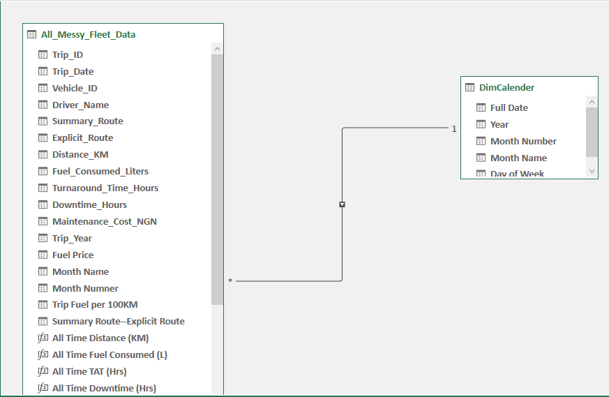
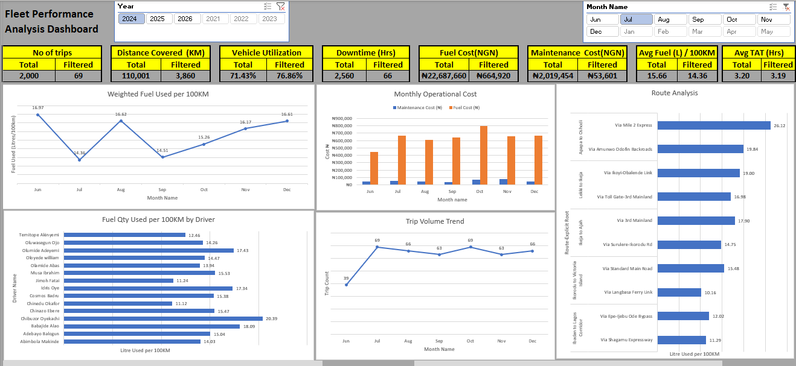
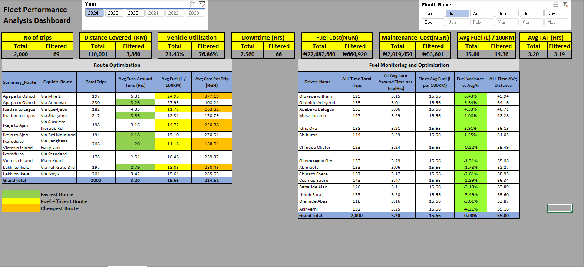
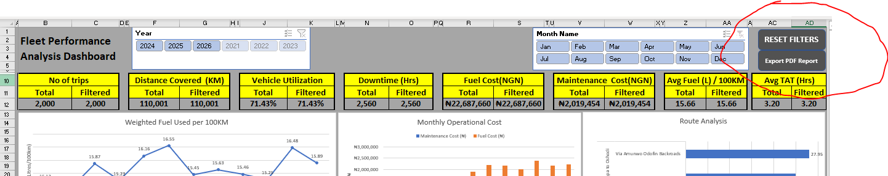
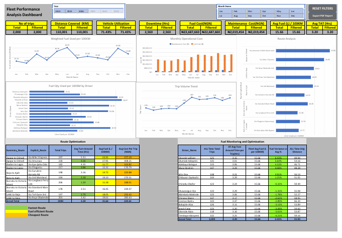

# Fleet Performance Analysis Dashboard

> **Disclaimer:** This dataset is **fictitious and for training purposes only**.
> Driver names, routes, fuel prices, costs, and trip records are simulated to demonstrate
> fleet analytics, Power Query cleaning, data modeling, and DAX measures.
> It does not represent any real company, driver, or operational data.

## Full Dashboard - PDF Export Output

> Screenshot above: This is the PDF copy you get in one click from the Export PDF Report button.
> It shows everything in one page - Top KPIs, all 5 charts, and both bottom tables.
> Total = Filtered = 2,000 trips because RESET FILTERS was clicked before exporting.

## What Is This Project?

A fleet performance dashboard built in Excel (Power Query + Power Pivot + DAX)
to monitor fuel efficiency, cost, turnaround time, downtime, and route performance
across 2,000 trips.

## Project Objectives

**Main Objective:**
To build a fleet performance dashboard that gives management a true, trustworthy view of fuel efficiency, cost, and route performance

### Specific Objectives

1.  **Clean the raw data**
    Remove duplicates, fix inconsistent driver names and routes, trim extra spaces, and round unrounded costs like 1066.66667 using Power Query - so the analysis starts from a clean 2,000-trip dataset.

2.  **Build a proper data model**
    Create a Star Schema with a Fact Table (2,000 trips) and a DimCalendar table, and merge Fuel Price in Power Query - so dates, months, and years filter correctly and measures calculate correctly.

3.  **Calculate a correct fleet benchmark**
    Calculate the  weighted fleet average (15.66 L / 100KM) - so drivers are judged fairly.

4.  **Compare routes properly**
    Rank all routes on 3 things at once - Fastest (TAT), Most Fuel-Efficient, and Cheapest - so management doesn't pick a route on cost alone.

5.  **Make the dashboard easy to use and share**
    Add 2 convenience buttons - RESET FILTERS to return to All Time in one click, and Export PDF Report to share the full dashboard as a PDF in one click.

8.  **Show where the money goes**
    Separate Fuel Cost (₦22,687,660) from Maintenance Cost (₦2,019,454) - so management can see that fuel, not maintenance, is the main cost lever.

## Key Findings (On n=2,000 - All Time)

### 1. No Driver Is Guilty

On the full 2,000 trips, **no driver is over +10% variance**.

- Highest: Oloyede William - **+6.43%** (125 trips, Fleet Avg 15.66) - Still Green
- Cosmos Badru - **-2.89%** (143 trips) - Actually *more* efficient than fleet average
- Lowest: Akinyemi - **-4.21%**

### 2. Cheapest Is Not Always Fastest, Fastest Is Not Always Cheapest

| Route | Avg TAT (Hrs) | Avg Fuel (L/100KM) | Avg Cost Per Trip (NGN) |
| :--- | :--- | :--- | :--- |
| Via Langbasa | 1.20 | 11.18 | 188.01 |
| Via Ikorodu Rd | 1.23 | 11.72 | 170.79 |
| Via Epe-Ijebu | 4.35 | 11.77 | 163.82 |
| Via Mile 2 | 5.31 | 24.95 | 377.19 |

**Best Overall:** Via Langbasa - Fastest, Most Fuel-Efficient, and Cheapest.
**Worst Overall:** Via Mile 2 Express - Slowest, Highest Fuel, Most Expensive.

### 3. Fuel Cost Dominates Maintenance

- Total Fuel Cost: **₦22,687,660**
- Total Maintenance Cost: **₦2,019,454**
- Fuel is ~11x maintenance. Fuel efficiency is the main lever for cost saving.

### 4. Fleet KPIs (All Time)

- Total Trips: **2,000**
- Distance Covered: **110,001 KM**
- Vehicle Utilization: **71.43%**
- Downtime: **2,560 Hrs**
- Avg Fuel: **15.66 L / 100KM**
- Avg Turnaround Time: **3.20 Hrs**

## Screenshots In This Repo

### 0. Raw Data - Before Cleaning

This is the starting point - messy on purpose.

What is wrong in this screenshot:
- Unrounded costs like **1066.66667** and **2933.33333** in Maintenance_Cost_NGN
- Inconsistent names - `Oloyede william` vs `Oloyede William`, `Oluwasegun Ojo` vs `Oluwasegun Ojo`
- Inconsistent routes - `Ikorodu to Victoria Island` vs `Ikorodu to Victoria Island` with extra spaces
- Mixed costs - 0, 2000, 16000, 2933.33333 - no standard format
- Duplicates and blank values in the full 2,000-row file

Columns in raw file: Trip_ID, Trip_Date, Vehicle_ID, Driver_Name, Summary_Route,
Explicit_Route, Distance_KM, Fuel_Consumed_Liters, Turnaround_Time_Hours,
Downtime_Hours, Maintenance_Cost_NGN

Example rows visible: TRP-260000 to TRP-260027, June 2024, Lagos routes
like Ikorodu to Victoria Island, Lekki to Ikeja, Apapa to Oshodi.

This is what Power Query had to fix in the next step.

### 1. Power Query Cleaning

Cleaned in Power Query. Applied Steps include:
- Renamed Columns, Removed Other Columns
- Trimmed Text (Driver_Name / Route)
- Rounded Off (Maintenance Cost)
- Duplicated Column / Extracted Year / Month Name / Month Number
- Added Conditional Column, Added Custom Column (Fuel Price)
- Changed Type

Result: Clean 2,000-row table ready for modeling.
This screenshot is the proof - the cleaning was not done by hand, it was done in Power Query.

### 2. Data Model

Star Schema:
- **Fact Table:** `All_Messy_Fleet_Data` (2,000 trips + DAX measures)
- **Dimension:** `DimCalendar` - Full Date, Year, Month Number, Month Name, Day of Week
    - Relationship: DimCalendar (1) -> Fact (Many) on Date

**Important Note on Fuel Price:** `Fuel_Table` is NOT joined in the Data Model.
Fuel Price was merged into the Fact Table inside Power Query via Grouping / Merge
on date, so Cost per Trip is already calculated before it hits the model.
The Fuel_Table visible in the model is a hidden reference table only.
This was done intentionally to keep the model fast and simple.
That is why the model shows No Connection for Fuel_Table - it is not a mistake.

### 3. Upper Dashboard - Filtered View

Slicer-driven view. Shows Total vs Filtered KPIs.
- Charts: Weighted Fuel Used per 100KM, Monthly Operational Cost,
  Fuel per 100KM by Driver, Trip Volume Trend, Route Analysis
- Slicers: Year (2021-2026), Month Name (Jan-Dec)
- Example in screenshot: Filtered to Jul 2024 = 69 trips, Avg Fuel 14.36

This view is *supposed* to move when you click slicers. That is its job.

### 4. Lower Dashboard - Locked View

Locked investigation view. Disconnected from slicers.
- **Route Optimization Table:** Total Trips, Avg TAT, Avg Fuel, Avg Cost per Trip
    - Green = Fastest, Yellow = Fuel-Efficient, Orange = Cheapest
- **Fuel Monitoring Table:** Driver_Name, All Time Total Trips, All Time Avg Turnaround,
  Fleet Avg Fuel, Fuel Variance %, All Time Avg Distance

This table always shows n=2,000, even when top slicers change.
This prevents small-sample false alarms. Grand Total now correctly shows 2,000.

### 5. Two Convenience Buttons

This is the close-up of the top-right corner. There are 2 buttons:

**1. RESET FILTERS**
Clears all Year / Month slicers and returns the dashboard to All Time (n=2,000).
Use this after exploring a filtered period like Jul 2024 / 69 trips.
When reset, Total = Filtered on all KPIs.

**2. Export PDF Report**
Prints the current dashboard view as a PDF in one click for sharing with management.

These 2 buttons are for convenience - one click to reset, one click to share.
Without RESET FILTERS, people get stuck on a filtered view and think the fleet only did 69 trips.

### 6. PDF Export - The Result

This is what you get when you click **Export PDF Report**.

It is NOT just the reset view. It is the PDF copy - the final shareable output.
It contains everything on one page:
- Top: 8 KPIs (Total vs Filtered)
- Middle: All 5 charts
- Bottom: Route Optimization Table + Fuel Monitoring Table

**Correct workflow:**
1. Click **RESET FILTERS** first - so Total = Filtered = 2,000
2. Then click **Export PDF Report** - so you export the full 2,000-trip view, not a 69-trip filtered view

That is why this PDF screenshot shows Total = Filtered = 2,000 on every KPI:
2,000 trips / 110,001 KM / 71.43% / 2,560 Hrs / ₦22,687,660 / ₦2,019,454 / 15.66 / 3.20

## How To Use This Dashboard

1. Use Year / Month slicers at the top to explore a period - Top KPIs and charts will move
2. Bottom tables will NOT move - they always show the All Time truth (n=2,000)
3. To check a driver, look at the bottom Fuel Monitoring table, not the filtered chart.
   A driver needs at least 100+ trips before you judge their variance.
4. To choose a route, compare all three columns - Fastest, Fuel-Efficient, Cheapest.
   Do not choose on cost alone.
5. Always click **RESET FILTERS** before you click **Export PDF Report**,
   so you export the full 2,000-trip view, not a 69-trip filtered view.

## Tools Used

- Microsoft Excel
- Power Query (Cleaning / Merging)
- Power Pivot / Data Model
- DAX Measures (All Time Distance, All Time Fuel, All Time TAT, etc.)
- Conditional Formatting

## Lesson Learned

> A 400% variance on n=1 is not fraud. It is noise.
> Always check sample size before you accuse someone.
> Always use a weighted average for a fleet benchmark, not a simple average.

---
*Project for training / portfolio purposes. Data is fictitious.*