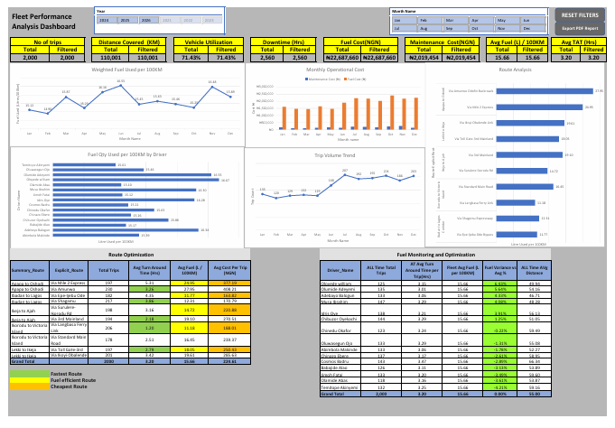
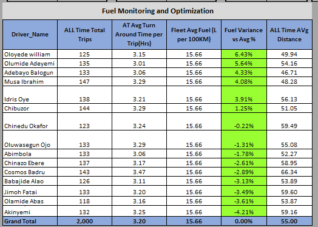
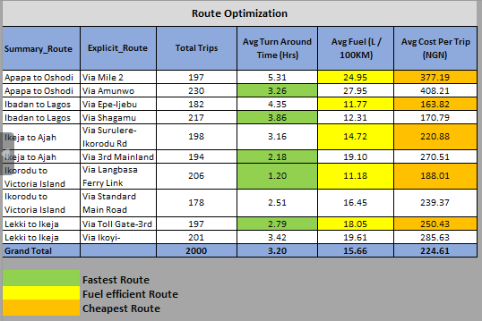
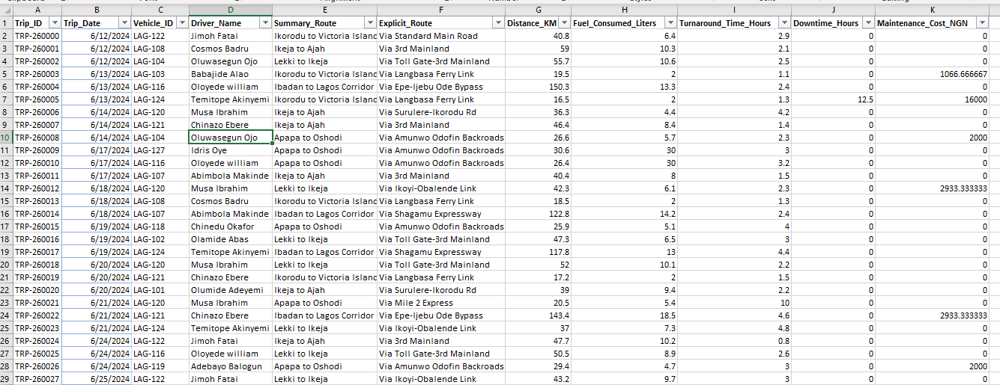
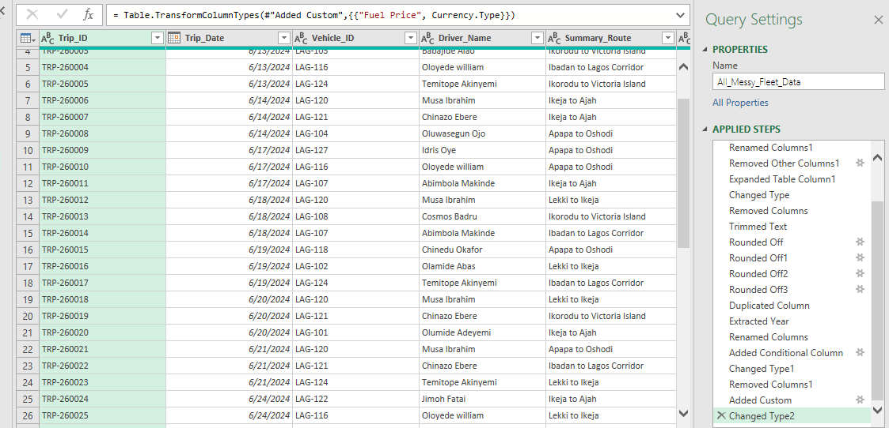
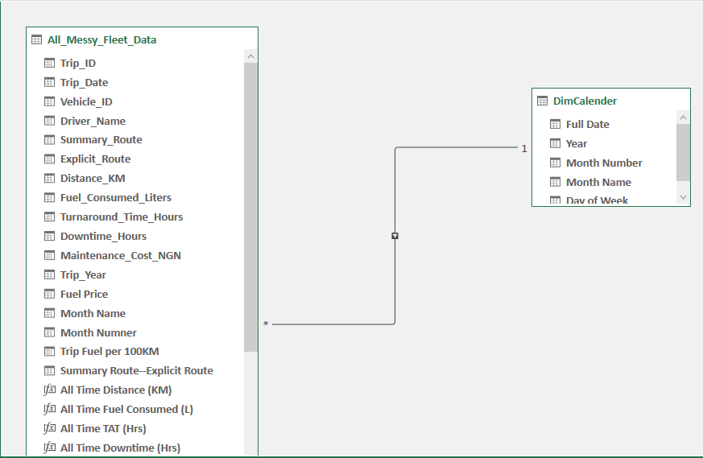
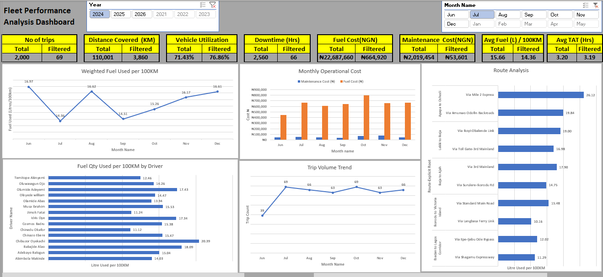
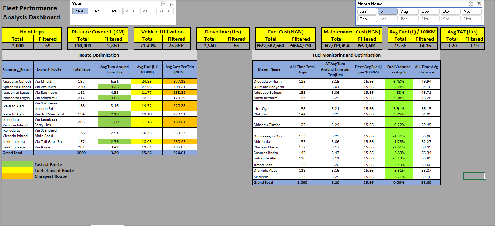
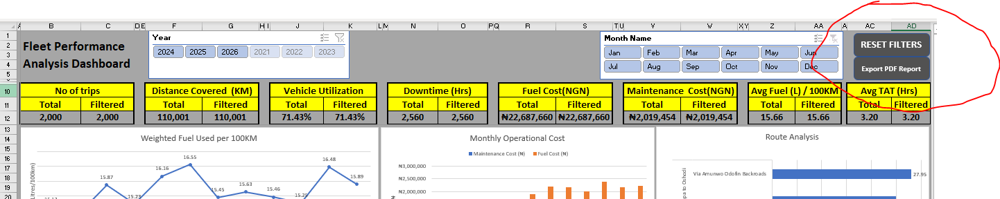

# Fleet Performance Analysis Dashboard

> **Disclaimer:** This dataset is **fictitious and for training purposes only**.
> Driver names, routes, fuel prices, costs, and trip records are simulated to demonstrate
> fleet analytics, Power Query cleaning, data modeling, and DAX measures.
> It does not represent any real company, driver, or operational data.

## Full Dashboard - PDF Export Output

> Screenshot above: This is the PDF copy you get in one click from the Export PDF Report button.
> It shows everything in one page - Top KPIs, all 5 charts, and both bottom tables.
> Total = Filtered = 2,000 trips because RESET FILTERS was clicked before exporting.

## What Is This Project?

A fleet performance dashboard built in Excel (Power Query + Power Pivot + DAX)
to monitor fuel efficiency, cost, turnaround time, downtime, and route performance
across 2,000 trips.

## Project Objectives

**Main Objective:**
To build a fleet performance dashboard that gives management a true, trustworthy view of fuel efficiency, cost, and route performance

### Specific Objectives

1.  **Clean the raw data**
    Remove duplicates, fix inconsistent driver names and routes, trim extra spaces, and round unrounded costs like 1066.66667 using Power Query - so the analysis starts from a clean 2,000-trip dataset.

2.  **Build a proper data model**
    Create a Star Schema with a Fact Table (2,000 trips) and a DimCalendar table, and merge Fuel Price in Power Query - so dates, months, and years filter correctly and measures calculate correctly.

3.  **Calculate a correct fleet benchmark**
    Calculate the  weighted fleet average (15.66 L / 100KM) - so drivers are judged fairly.

4.  **Compare routes properly**
    Rank all routes on 3 things at once - Fastest (TAT), Most Fuel-Efficient, and Cheapest - so management doesn't pick a route on cost alone.

5.  **Make the dashboard easy to use and share**
    Add 2 convenience buttons - RESET FILTERS to return to All Time in one click, and Export PDF Report to share the full dashboard as a PDF in one click.

8.  **Show where the money goes**
    Separate Fuel Cost (₦22,687,660) from Maintenance Cost (₦2,019,454) - so management can see that fuel, not maintenance, is the main cost lever.

## Key Findings (On n=2,000 - All Time)

### 1. No Driver Is Guilty

On the full 2,000 trips, **no driver is over +10% variance**.

- Highest: Oloyede William - **+6.43%** (125 trips, Fleet Avg 15.66) - Still Green
- Cosmos Badru - **-2.89%** (143 trips) - Actually *more* efficient than fleet average
- Lowest: Akinyemi - **-4.21%**

### 2. Cheapest Is Not Always Fastest, Fastest Is Not Always Cheapest

## Findings - Route Optimization

> Source: Route Optimization Table - All Time (n=2,000 trips)
> Grand Total: Avg TAT 3.20 Hrs | Avg Fuel 15.66 L / 100KM | Avg Cost Per Trip ₦224.61
> Rule: Only compare Explicit Routes that share the same Summary Route.
> Do NOT compare Ibadan to Lagos vs Ikorodu to Victoria Island - they are different journeys.

### Legend

- **Green = Fastest** - Lowest Avg Turn Around Time inside that Summary Route
- **Yellow = Most Fuel-Efficient** - Lowest Avg Fuel (L / 100KM) inside that Summary Route
- **Orange = Cheapest** - Lowest Avg Cost Per Trip inside that Summary Route

---

### 1. Summary Route: Apapa to Oshodi (427 trips total)

| Explicit Route | Total Trips | Avg TAT (Hrs) | Avg Fuel (L / 100KM) | Avg Cost Per Trip (NGN) |
| :--- | :--- | :--- | :--- | :--- |
| Via Mile 2 | 197 | 5.31 | 24.95 | 377.19 |
| Via Amunwo | 230 | 3.26 | 27.95 | 408.21 |

**Finding:**
- Fastest: **Via Amunwo (3.26 Hrs)** - 2.05 Hrs faster than Via Mile 2
- Most Fuel-Efficient: **Via Mile 2 (24.95)** - uses 3.00 L / 100KM less than Via Amunwo
- Cheapest: **Via Mile 2 (₦377.19)** - saves ₦31.02 per trip vs Via Amunwo

**Trade-off:** No route wins all 3. Via Amunwo wins on speed, Via Mile 2 wins on fuel and cost.
If time matters, choose Via Amunwo. If cost / fuel matters, choose Via Mile 2.
Both routes are high on fuel vs fleet average (15.66) - this Summary Route as a whole needs investigation.

### 2. Summary Route: Ibadan to Lagos (399 trips total)

| Explicit Route | Total Trips | Avg TAT (Hrs) | Avg Fuel (L / 100KM) | Avg Cost Per Trip (NGN) |
| :--- | :--- | :--- | :--- | :--- |
| Via Epe-Ijebu | 182 | 4.35 | 11.77 | 163.82 |
| Via Shagamu | 217 | 3.86 | 12.31 | 170.79 |

**Finding:**
- Fastest: **Via Shagamu (3.86 Hrs)** - 0.49 Hrs faster than Via Epe-Ijebu
- Most Fuel-Efficient: **Via Epe-Ijebu (11.77)** - uses 0.54 L / 100KM less than Via Shagamu
- Cheapest: **Via Epe-Ijebu (₦163.82)** - saves ₦6.97 per trip vs Via Shagamu

**Trade-off:** Very close. Via Epe-Ijebu wins on fuel and cost, Via Shagamu wins on speed by only 29 minutes.
Both routes are well below fleet average fuel (15.66), so both are efficient.
For this Summary Route, Via Epe-Ijebu is the better balanced choice unless the 29 minutes is critical.

### 3. Summary Route: Ikeja to Ajah (392 trips total)

| Explicit Route | Total Trips | Avg TAT (Hrs) | Avg Fuel (L / 100KM) | Avg Cost Per Trip (NGN) |
| :--- | :--- | :--- | :--- | :--- |
| Via Surulere-Ikorodu Rd | 198 | 3.16 | 14.72 | 220.88 |
| Via 3rd Mainland | 194 | 2.18 | 19.10 | 270.51 |

**Finding:**
- Fastest: **Via 3rd Mainland (2.18 Hrs)** - 0.98 Hrs faster than Via Surulere-Ikorodu Rd
- Most Fuel-Efficient: **Via Surulere-Ikorodu Rd (14.72)** - uses 4.38 L / 100KM less than Via 3rd Mainland
- Cheapest: **Via Surulere-Ikorodu Rd (₦220.88)** - saves ₦49.63 per trip vs Via 3rd Mainland

**Trade-off:** Clear split. 3rd Mainland saves ~59 minutes, but costs ₦49.63 more and burns more fuel per trip.
If the trip is time-sensitive, choose 3rd Mainland. If not, Surulere-Ikorodu Rd is the better default.

### 4. Summary Route: Ikorodu to Victoria Island (384 trips total)

| Explicit Route | Total Trips | Avg TAT (Hrs) | Avg Fuel (L / 100KM) | Avg Cost Per Trip (NGN) |
| :--- | :--- | :--- | :--- | :--- |
| Via Langbasa Ferry Link | 206 | 1.20 | 11.18 | 188.01 |
| Via Standard Main Road | 178 | 2.51 | 16.45 | 239.37 |

**Finding:**
- Fastest: **Via Langbasa Ferry Link (1.20 Hrs)** - 1.31 Hrs faster than Standard Main Road
- Most Fuel-Efficient: **Via Langbasa Ferry Link (11.18)** - uses 5.27 L / 100KM less than Standard Main Road
- Cheapest: **Via Langbasa Ferry Link (₦188.01)** - saves ₦51.36 per trip vs Standard Main Road

**Trade-off:** No trade-off. Via Langbasa Ferry Link wins on all 3 inside this Summary Route.
This is the only Summary Route where one Explicit Route sweeps Fastest + Fuel-Efficient + Cheapest.
For Ikorodu to Victoria Island, Langbasa should be the default choice.

### 5. Summary Route: Lekki to Ikeja (398 trips total)

| Explicit Route | Total Trips | Avg TAT (Hrs) | Avg Fuel (L / 100KM) | Avg Cost Per Trip (NGN) |
| :--- | :--- | :--- | :--- | :--- |
| Via Toll Gate-3rd | 197 | 2.79 | 18.05 | 250.43 |
| Via Ikoyi- | 201 | 3.42 | 19.61 | 285.63 |

**Finding:**
- Fastest: **Via Toll Gate-3rd (2.79 Hrs)** - 0.63 Hrs faster than Via Ikoyi-
- Most Fuel-Efficient: **Via Toll Gate-3rd (18.05)** - uses 1.56 L / 100KM less than Via Ikoyi-
- Cheapest: **Via Toll Gate-3rd (₦250.43)** - saves ₦35.20 per trip vs Via Ikoyi-

**Trade-off:** No trade-off. Via Toll Gate-3rd wins on all 3 inside this Summary Route.
For Lekki to Ikeja, Toll Gate-3rd should be the default choice.

---

### Overall Takeaway - By Summary Route, Not Across Routes

- **Apapa to Oshodi:** Split - Amunwo = Fastest, Mile 2 = Fuel-Efficient + Cheapest. Choose based on priority.
- **Ibadan to Lagos:** Split - Shagamu = Fastest, Epe-Ijebu = Fuel-Efficient + Cheapest. Difference is small.
- **Ikeja to Ajah:** Split - 3rd Mainland = Fastest, Surulere-Ikorodu Rd = Fuel-Efficient + Cheapest.
- **Ikorodu to Victoria Island:** Clear winner - Langbasa Ferry Link wins all 3.
- **Lekki to Ikeja:** Clear winner - Toll Gate-3rd wins all 3.

### 3. Fuel Cost Dominates Maintenance

- Total Fuel Cost: **₦22,687,660**
- Total Maintenance Cost: **₦2,019,454**
- Fuel is ~11x maintenance. Fuel efficiency is the main lever for cost saving.

### 4. Fleet KPIs (All Time)

- Total Trips: **2,000**
- Distance Covered: **110,001 KM**
- Vehicle Utilization: **71.43%**
- Downtime: **2,560 Hrs**
- Avg Fuel: **15.66 L / 100KM**
- Avg Turnaround Time: **3.20 Hrs**

## Screenshots In This Repo

### 0. Raw Data - Before Cleaning

This is the starting point - messy on purpose.

What is wrong in this screenshot:
- Unrounded costs like **1066.66667** and **2933.33333** in Maintenance_Cost_NGN
- Inconsistent names - `Oloyede william` vs `Oloyede William`, `Oluwasegun Ojo` vs `Oluwasegun Ojo`
- Inconsistent routes - `Ikorodu to Victoria Island` vs `Ikorodu to Victoria Island` with extra spaces
- Mixed costs - 0, 2000, 16000, 2933.33333 - no standard format
- Duplicates and blank values in the full 2,000-row file

Columns in raw file: Trip_ID, Trip_Date, Vehicle_ID, Driver_Name, Summary_Route,
Explicit_Route, Distance_KM, Fuel_Consumed_Liters, Turnaround_Time_Hours,
Downtime_Hours, Maintenance_Cost_NGN

Example rows visible: TRP-260000 to TRP-260027, June 2024, Lagos routes
like Ikorodu to Victoria Island, Lekki to Ikeja, Apapa to Oshodi.

This is what Power Query had to fix in the next step.

### 1. Power Query Cleaning

Cleaned in Power Query. Applied Steps include:
- Renamed Columns, Removed Other Columns
- Trimmed Text (Driver_Name / Route)
- Rounded Off (Maintenance Cost)
- Duplicated Column / Extracted Year / Month Name / Month Number
- Added Conditional Column, Added Custom Column (Fuel Price)
- Changed Type

Result: Clean 2,000-row table ready for modeling.
This screenshot is the proof - the cleaning was not done by hand, it was done in Power Query.

### 2. Data Model

Star Schema:
- **Fact Table:** `All_Messy_Fleet_Data` (2,000 trips + DAX measures)
- **Dimension:** `DimCalendar` - Full Date, Year, Month Number, Month Name, Day of Week
    - Relationship: DimCalendar (1) -> Fact (Many) on Date

### 3. Upper Dashboard - Filtered View

Slicer-driven view. Shows Total vs Filtered KPIs.
- Charts: Weighted Fuel Used per 100KM, Monthly Operational Cost,
  Fuel per 100KM by Driver, Trip Volume Trend, Route Analysis
- Slicers: Year (2024-2026), Month Name (Jan-Dec)
- Example in screenshot: Filtered to Jul 2024 = 69 trips, Avg Fuel 14.36

This view is *supposed* to move when you click slicers. That is its job.

### 4. Lower Dashboard - Locked View

Locked investigation view. Disconnected from slicers.
- **Route Optimization Table:** Total Trips, Avg TAT, Avg Fuel, Avg Cost per Trip
    - Green = Fastest, Yellow = Fuel-Efficient, Orange = Cheapest
- **Fuel Monitoring Table:** Driver_Name, All Time Total Trips, All Time Avg Turnaround,
  Fleet Avg Fuel, Fuel Variance %, All Time Avg Distance

This table always shows n=2,000, even when top slicers change.
This prevents small-sample false alarms. Grand Total now correctly shows 2,000.

### 5. Two Convenience Buttons

This is the close-up of the top-right corner. There are 2 buttons:

**1. RESET FILTERS**
Clears all Year / Month slicers and returns the dashboard to All Time (n=2,000).
Use this after exploring a filtered period like Jul 2024 / 69 trips.
When reset, Total = Filtered on all KPIs.

**2. Export PDF Report**
Prints the current dashboard view as a PDF in one click for sharing with management.

These 2 buttons are for convenience - one click to reset, one click to share.
Without RESET FILTERS, people get stuck on a filtered view and think the fleet only did 69 trips.

### 6. PDF Export - The Result

This is what you get when you click **Export PDF Report**.

It is NOT just the reset view. It is the PDF copy - the final shareable output.
It contains everything on one page:
- Top: 8 KPIs (Total vs Filtered)
- Middle: All 5 charts
- Bottom: Route Optimization Table + Fuel Monitoring Table

## How To Use This Dashboard

1. Use Year / Month slicers at the top to explore a period - Top KPIs and charts will move
2. Bottom tables will NOT move - they always show the All Time truth (n=2,000)
3. To check a driver, look at the bottom Fuel Monitoring table, not the filtered chart.
   A driver needs at least 100+ trips before you judge their variance.
4. To choose a route, compare all three columns - Fastest, Fuel-Efficient, Cheapest.
   Do not choose on cost alone.
5. Always click **RESET FILTERS** before you click **Export PDF Report**,
   so you export the full 2,000-trip view, not a 69-trip filtered view.

## Tools Used

- Microsoft Excel
- Power Query (Cleaning / Merging)
- Power Pivot / Data Model
- DAX Measures (All Time Distance, All Time Fuel, All Time TAT, etc.)
- Conditional Formatting

## Skills Demonstrated

### 1. Data Cleaning - Power Query
- Removing duplicates
- Trimming text and extra spaces (Driver_Name, Route)
- Renaming columns
- Removing unnecessary columns
- Rounding off values (Maintenance_Cost_NGN e.g. 1066.66667)
- Changing data types
- Duplicating column
- Extracting Year, Month Name, Month Number from Date
- Adding Conditional Column
- Adding Custom Column (Fuel Price)
- Merging tables (Fuel_Table into Fact Table on Date)
- Grouping data

### 2. Data Modeling - Power Pivot
- Building a Star Schema
- Creating Fact Table (All_Messy_Fleet_Data - 2,000 trips)
- Creating Dimension Table (DimCalendar)
- Creating 1-to-Many relationship (DimCalendar -> Fact on Date)
- Understanding why Fuel_Table is intentionally left unconnected / hidden reference table
- Keeping model fast and simple

### 3. DAX Measures
- Total Trips
- Total Distance (All Time)
- Total Fuel Consumed (All Time)
- Weighted Avg Fuel per 100KM (Total Fuel / Total Distance * 100)
- Avg Turnaround Time (All Time)
- Avg Cost Per Trip
- Total Fuel Cost
- Total Maintenance Cost
- All Time measures that ignore slicers (using ALL / REMOVEFILTERS logic)
- Filtered measures that respond to slicers (Total vs Filtered)

### 4. Dashboard Design - Excel
- KPI cards (Total vs Filtered)
- Slicers (Year, Month Name)
- Charts: Weighted Fuel per 100KM, Monthly Operational Cost, Fuel per 100KM by Driver, Trip Volume Trend, Route Analysis
- Tables: Route Optimization Table, Fuel Monitoring Table
- Conditional Formatting (Green / Yellow / Orange for Fastest / Fuel-Efficient / Cheapest)
- Conditional Formatting for Fuel Variance (Green -5% to +10%, Yellow +10% to +20%, Red > +20%)
- Locking tables from slicers to prevent small-sample errors
- Adding buttons: RESET FILTERS and Export PDF Report
- PDF Export layout for management sharing

### 5. Analytical Thinking / Investigation
- Identifying a false alarm (+400% fuel variance)
- Checking sample size (n=1 vs n=2,000)
- Identifying slicer trap (bottom tables connected to slicers)
- Correcting a wrong benchmark (unweighted 21.13 vs weighted 15.66)
- Understanding weighted vs unweighted averages
- Understanding small-sample noise vs real evidence
- Comparing routes correctly - only within the same Summary Route (A to B), not across different routes
- Trade-off analysis: Fastest vs Most Fuel-Efficient vs Cheapest

### 6. Business Storytelling / Communication
- Turning numbers into a story (false fraud accusation -> investigation -> correction)
- Writing clear findings per Summary Route
- Writing clear recommendations per route pair
- Writing objectives, findings, and lessons learned for portfolio / GitHub
- Presenting results in a way management can use in one click (PDF)

### 7. Documentation / Portfolio - GitHub
- Writing README.md
- Explaining method with screenshots only (no real data shared for privacy)
- Structuring a project: Raw Data -> Cleaning -> Model -> Dashboard -> Findings
- Using markdown: tables, headings, images, notes, disclaimers

---
*Project for training / portfolio purposes. Data is fictitious.*